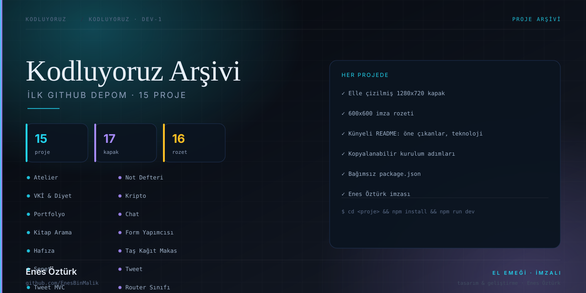

<div align="center">



# Kodluyoruz — İlk GitHub Depom

**Frontend yolculuğumun arşivi.** Her proje kendi klasöründe, kendi kapağıyla, kendi README'siyle.

<a href="#projeler"></a>


<sub>Tasarım ve geliştirme — <a href="https://github.com/EnesBinMalik">Enes Öztürk</a></sub>

</div>

---

## Projeler

<div align="center">

| # | Proje | Tür | Teknoloji | |
|:-:|---|---|---|:-:|
| <sub>`01`</sub> | [İlk GitHub Depom](README.md) | Kodluyoruz Frontend 101 · Ödev 1 | <sub>—</sub> | [kapak](README.md/docs/kapak.svg) |
| <sub>`03`</sub> | [Atelier — Lüks Giyim & E-Ticaret](enes-%C3%B6zt%C3%BCrk-atelier-_-l%C3%BCks-giyim-%26-e-ticaret) | E-ticaret vitrini | <sub>React · TypeScript</sub> | [kapak](enes-%C3%B6zt%C3%BCrk-atelier-_-l%C3%BCks-giyim-%26-e-ticaret/docs/kapak.svg) |
| <sub>`04`</sub> | [Not Defteri](not-defteri---enes-%C3%B6zt%C3%BCrk) | Not tutma uygulaması | <sub>React · localStorage</sub> | [kapak](not-defteri---enes-%C3%B6zt%C3%BCrk/docs/kapak.svg) |
| <sub>`05`</sub> | [VKİ & Diyet Rehberi](v%C3%BCcut-kitle-endeksi-%26-diyet-rehberi) | Sağlık asistanı | <sub>React · TypeScript</sub> | [kapak](v%C3%BCcut-kitle-endeksi-%26-diyet-rehberi/docs/kapak.svg) |
| <sub>`06`</sub> | [Kripto Para — Canlı Fiyat Takip](kripto-para---canl%C4%B1-fiyat-takip-platformu) | Finans paneli | <sub>React · CoinGecko API</sub> | [kapak](kripto-para---canl%C4%B1-fiyat-takip-platformu/docs/kapak.svg) |
| <sub>`07`</sub> | [Portfolyo & Blog](enes-%C3%B6zt%C3%BCrk---portfolyo-%26-blog) | Kişisel site | <sub>React · React Router</sub> | [kapak](enes-%C3%B6zt%C3%BCrk---portfolyo-%26-blog/docs/kapak.svg) |
| <sub>`08`</sub> | [Gerçek Zamanlı Chat](ger%C3%A7ek-zamanl%C4%B1-chat-uygulamas%C4%B1) | Socket.io sohbet | <sub>React · Node · Socket.io</sub> | [kapak](ger%C3%A7ek-zamanl%C4%B1-chat-uygulamas%C4%B1/docs/kapak.svg) |
| <sub>`09`</sub> | [Kitap Arama](kitap-arama-uygulamas%C4%B1---enes-%C3%B6zt%C3%BCrk) | Google Books kütüphanesi | <sub>React · Google Books API</sub> | [kapak](kitap-arama-uygulamas%C4%B1---enes-%C3%B6zt%C3%BCrk/docs/kapak.svg) |
| <sub>`10`</sub> | [Form Yapımcısı](form-yap%C4%B1mc%C4%B1s%C4%B1) | Sürükle-bırak form aracı | <sub>React · sürükle-bırak</sub> | [kapak](form-yap%C4%B1mc%C4%B1s%C4%B1/docs/kapak.svg) |
| <sub>`11`</sub> | [Hafıza Oyunu](haf%C4%B1za-oyunu---frontend-projeleri-_-enes-%C3%B6zt%C3%BCrk) | 4×3 kart eşleştirme | <sub>React · Web Audio</sub> | [kapak](haf%C4%B1za-oyunu---frontend-projeleri-_-enes-%C3%B6zt%C3%BCrk/docs/kapak.svg) |
| <sub>`12`</sub> | [Taş Kağıt Makas](ta%C5%9F-ka%C4%9F%C4%B1t-makas) | Bilgisayara karşı oyun | <sub>React · Web Audio</sub> | [kapak](ta%C5%9F-ka%C4%9F%C4%B1t-makas/docs/kapak.svg) |

</div>

> Kapak ve rozetlerin tamamı **elle çizilmiş SVG** dosyalarıdır — hazır şablon ya da stok görsel yok.
> Üreteç: [`tools/kapaklar.py`](tools/kapaklar.py)

---

## Hızlı başlangıç

Her proje kendi klasöründe bağımsız çalışır:

```bash
git clone https://github.com/EnesBinMalik/Kodluyoruz---lk-GitHub-Depom-dev-1-.git
cd Kodluyoruz---lk-GitHub-Depom-dev-1-

cd kitap-arama-uygulaması---enes-öztürk   # örnek proje
npm install
npm run dev                                # http://localhost:3000
```

| Komut | Ne yapar |
|---|---|
| `npm install` | Bağımlılıkları kurar |
| `npm run dev` | Geliştirme sunucusunu açar (chat projesinde `tsx server.ts`) |
| `npm run build` | Üretim derlemesi üretir |
| `npm run preview` | Derlemeyi yerelde önizler |

---

## Depo düzeni

```text
Kodluyoruz---lk-GitHub-Depom-dev-1-/
├── README.md                  # bu sayfa
├── docs/
│   ├── kapak.svg              # depo kapağı (elle çizildi)
│   └── rozet.svg              # depo rozeti
├── tools/
│   └── kapaklar.py            # tüm kapak + rozetleri üreten betik
├── src/                       # kök vitrin uygulaması (Vite)
├── <proje-klasörü>/
│   ├── docs/
│   │   ├── kapak.svg          # 1280×720 proje kapağı
│   │   └── rozet.svg          # 600×600 imza rozeti
│   ├── src/
│   ├── package.json
│   └── README.md              # öne çıkanlar · teknoloji · kurulum
└── ...
```

---

## Kapakları yeniden üretmek

Bir projeyi kataloğa ekleyip tek komutla kapak + rozet üretebilirsiniz:

```bash
python tools/kapaklar.py
```

`tools/kapaklar.py` içindeki `PROJECTS` listesine `(klasör, ad, numara, renk1, renk2, çizim)` satırı eklemek yeterli.

---

## Notlar

- `node_modules` ve `.git` hiçbir zaman depoya alınmaz.
- Projelerin hiçbiri diğerine bağımlı değildir; tek tek klonlanabilir.
- Tüm görsellerde imza künyesi bulunur: **Enes Öztürk** · [github.com/EnesBinMalik](https://github.com/EnesBinMalik)

---

<div align="center">
<sub>Bu depo <b>Enes Öztürk</b> tarafından tasarlanıp geliştirilmiştir · MIT</sub><br/>
<sub><a href="https://github.com/EnesBinMalik">github.com/EnesBinMalik</a></sub>
</div>
