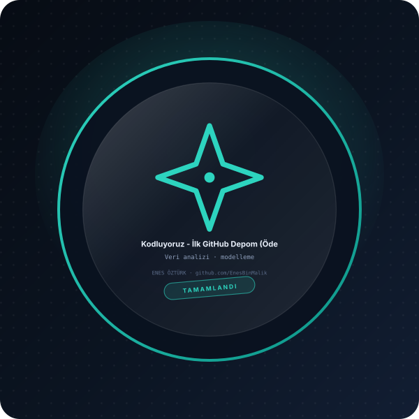

# Kodluyoruz - İlk GitHub Depom (Ödev 1)



> **Kodluyoruz Frontend 101 · Ödev 1 + 3 proje** — tasarım ve geliştirme: **Enes Öztürk**

---

Kodluyoruz Frontend 101 Eğitimi Ödev 1: GitHub Repo İşlemleri, kodluyoruzilkrepo teslim asistanı ve interaktif Git rehberi.


## Bu depodaki projeler

| # | Proje | Tür | Kapak |
|:-:|---|---|---|
| 01 | [İlk GitHub Depom](README.md) | Kodluyoruz Frontend 101 · Ödev 1 | bu sayfa |
| 03 | [Atelier — Lüks Giyim & E-Ticaret](enes-öztürk-atelier-_-lüks-giyim-&-e-ticaret) | E-ticaret vitrini | `docs/kapak.svg` |
| 04 | [Not Defteri](not-defteri---enes-öztürk) | Not tutma uygulaması | `docs/kapak.svg` |
| 05 | [VKİ & Diyet Rehberi](vücut-kitle-endeksi-&-diyet-rehberi) | Sağlık asistanı | `docs/kapak.svg` |

Her proje kendi klasöründe bağımsız çalışır: `cd <klasör> && npm install && npm run dev`.

## Öne çıkanlar

- **Git rehberi** — `git init`, `add`, `commit`, `push` adımlarının görsel anlatımı
- **Repo teslim asistanı** — ödev teslim adımlarının kontrol listesi
- **Tek depo, dört proje** — aşağıdaki üç proje aynı imza diliyle bu depoda
- **Bağımsız çalışma** — her proje kendi `package.json`'ı ile ayağa kalkar

## Kurulum ve çalıştırma

```bash
npm install
npm run dev        # http://localhost:3000
```

| Komut | Not |
| --- | --- |
| `npm install` | bağımlılıklar |
| `npm run dev` | geliştirme sunucusu |
| `npm run build` | üretim derlemesi |

## Proje yapısı

```
├── index.html
├── package.json
├── docs/rozet.svg        # imza rozeti
└── src/                  # uygulama kaynakları
```

## Lisans

Bu proje **Enes Öztürk** tarafından geliştirilmiştir; tüm hakları saklıdır.
