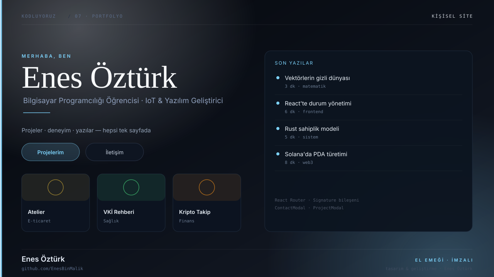
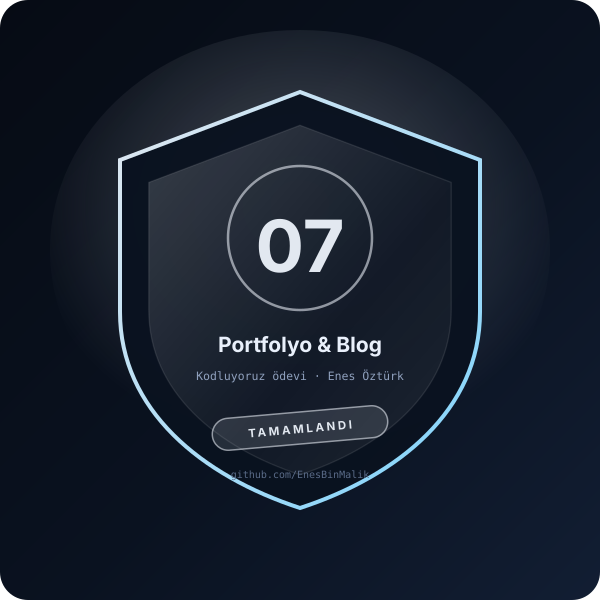

# Enes Öztürk — Portfolyo & Blog



> **Kodluyoruz · KİŞİSEL SİTE** — tasarım ve geliştirme: **Enes Öztürk**

<p align="center"></p>

---

Kişisel portfolyo ve teknik blog: projeler, deneyimler ve yazılar tek sitede; imza bileşeni ve modallarla sade bir anlatım.

## Öne çıkanlar

- **Ana sayfa** — tanıtım, öne çıkan projeler ve iletişim çağrısı
- **Projeler** — `ProjectModal` ile detay görünümü
- **Blog** — teknik yazılar listesi (`BlogPage`)
- **Hakkımda** — eğitim ve deneyim çizgisi
- **İmza** — `Signature` bileşeni ile kişisel imza bloğu
- **İletişim** — `ContactModal` formu

## Teknoloji

React · TypeScript · Vite · React Router · lucide-react

## Kurulum ve çalıştırma

```bash
npm install
npm run dev        # http://localhost:3000
```

| Komut | Not |
| --- | --- |
| `npm install` | bağımlılıklar |
| `npm run dev` | geliştirme sunucusu (chat: `tsx server.ts`) |
| `npm run build` | üretim derlemesi |

## Proje yapısı

```
enes-öztürk---portfolyo-&-blog/
├── index.html
├── package.json
├── docs/
│   ├── kapak.svg          # elle çizilmiş proje kapağı
│   └── rozet.svg          # imza rozeti
└── src/
```

## Lisans

MIT · bu proje **Enes Öztürk** tarafından geliştirilmiştir.
