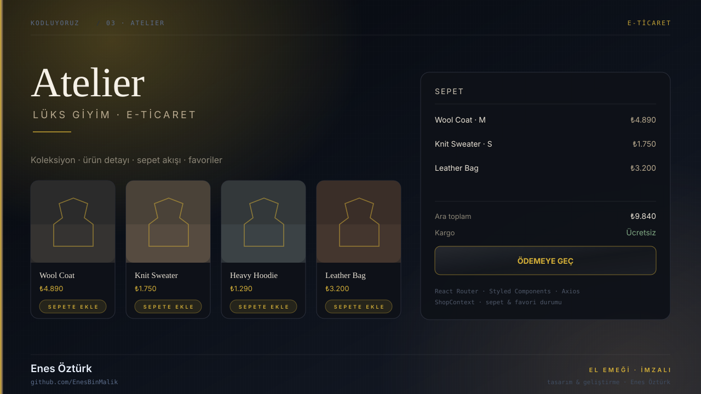
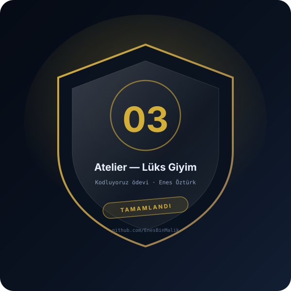

# Atelier — Lüks Giyim & E-Ticaret



> **Kodluyoruz · E-TİCARET** — tasarım ve geliştirme: **Enes Öztürk**

<p align="center"></p>

---

Lüks giyim koleksiyonu için vitrin, ürün detayı, sepet ve favori akışını tek arayüzde toplayan e-ticaret platformu; React Router, Styled Components ve Axios ile.

## Öne çıkanlar

- **Koleksiyon vitrini** — kategoriye göre filtrelenen ürün kartları
- **Ürün detayı** — beden/renk seçimi, galeri ve sepete ekleme
- **Sepet çekmecesi** — ara toplam, kargo ve ödeme adımı
- **Favoriler** — `ShopContext` ile kalıcı durum
- **Styling** — `styled-components` ile tema; `axios` servis katmanı

## Teknoloji

React 19 · TypeScript · Vite · React Router · styled-components · axios · lucide-react

## Kurulum ve çalıştırma

```bash
npm install
npm run dev        # http://localhost:3000
```

| Komut | Not |
| --- | --- |
| `npm install` | bağımlılıklar |
| `npm run dev` | geliştirme sunucusu |
| `npm run build` | üretim derlemesi |

## Proje yapısı

```
enes-öztürk-atelier-_-lüks-giyim-&-e-ticaret/
├── index.html
├── package.json
├── docs/
│   ├── kapak.svg          # elle çizilmiş proje kapağı
│   └── rozet.svg          # imza rozeti
└── src/
```

## Lisans

MIT · bu proje **Enes Öztürk** tarafından geliştirilmiştir.
