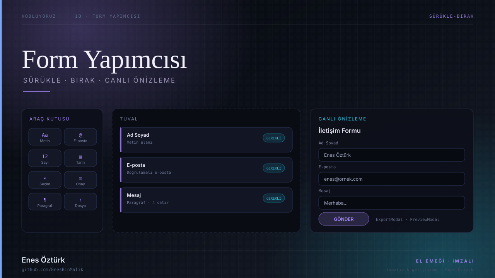
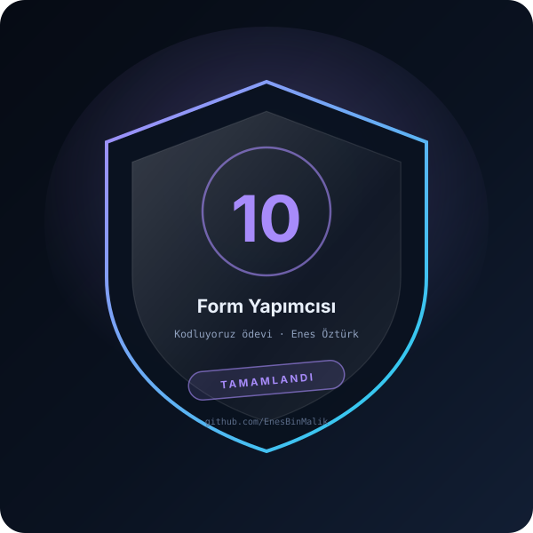

# Form Yapımcısı



> **Kodluyoruz · SÜRÜKLE-BIRAK** — tasarım ve geliştirme: **Enes Öztürk**

<p align="center"></p>

---

Sürükle-bırak ile form oluşturma, alan düzenleme ve canlı önizleme; oluşan formu dışa aktarma aracı.

## Öne çıkanlar

- **Araç kutusu** — metin, e-posta, sayı, tarih, seçim, onay, paragraf, dosya
- **Tuval** — `Canvas` üzerine sürükle-bırak ile alan yerleştirme
- **Alan düzenleyici** — `FieldEditor` ile etiket, zorunluluk ve doğrulama
- **Canlı önizleme** — `PreviewModal` ile gerçek form görünümü
- **Dışa aktarma** — `ExportModal` ile form yapısını alma
- **İmza** — `SignatureFooter` bileşeni

## Teknoloji

React · TypeScript · Vite · sürükle-bırak

## Kurulum ve çalıştırma

```bash
npm install
npm run dev        # http://localhost:3000
```

| Komut | Not |
| --- | --- |
| `npm install` | bağımlılıklar |
| `npm run dev` | geliştirme sunucusu |
| `npm run build` | üretim derlemesi |

## Proje yapısı

```
form-yapımcısı/
├── index.html
├── package.json
├── docs/
│   ├── kapak.svg          # elle çizilmiş proje kapağı
│   └── rozet.svg          # imza rozeti
└── src/
```

## Lisans

MIT · bu proje **Enes Öztürk** tarafından geliştirilmiştir.
