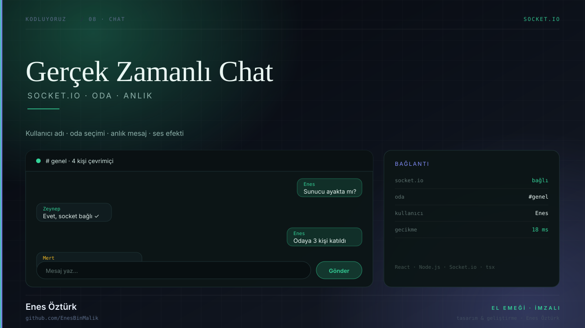

# Gerçek Zamanlı Chat Uygulaması



> **Kodluyoruz · SOCKET.IO** — tasarım ve geliştirme: **Enes Öztürk**

<p align="center"></p>

---

Socket.io üzerinden anlık mesajlaşan, oda ve kullanıcı yönetimi olan sohbet uygulaması; sunucu ve arayüz aynı komutla ayağa kalkar.

## Öne çıkanlar

- **Anlık mesajlaşma** — Socket.io olayları, gecikmesiz iletim
- **Oda ve kullanıcı** — girişte ad ve oda seçimi (`LoginModal`)
- **Mesaj alanı** — `ChatArea` ile baloncuk düzeni, otomatik kaydırma
- **Kenar çubuğu** — `Sidebar` ile oda ve çevrimiçi liste
- **Ses efekti** — `src/utils/sound.ts` ile mesaj bildirimi
- **Sunucu** — `server.ts` (`npm run dev` → tsx server.ts)

## Teknoloji

React · TypeScript · Vite · Node.js · Socket.io

## Kurulum ve çalıştırma

```bash
npm install
npm run dev        # http://localhost:3000
```

| Komut | Not |
| --- | --- |
| `npm install` | bağımlılıklar |
| `npm run dev` | geliştirme sunucusu (chat: `tsx server.ts`) |
| `npm run build` | üretim derlemesi |

## Proje yapısı

```
gerçek-zamanlı-chat-uygulaması/
├── index.html
├── package.json
├── docs/
│   ├── kapak.svg          # elle çizilmiş proje kapağı
│   └── rozet.svg          # imza rozeti
└── src/
```

## Lisans

MIT · bu proje **Enes Öztürk** tarafından geliştirilmiştir.
