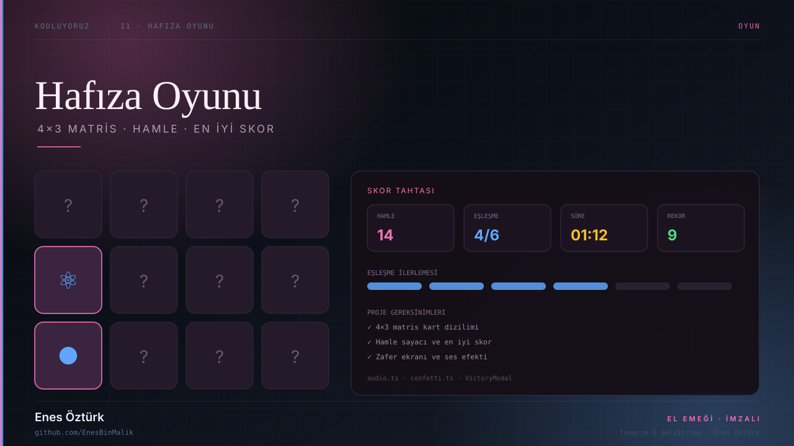
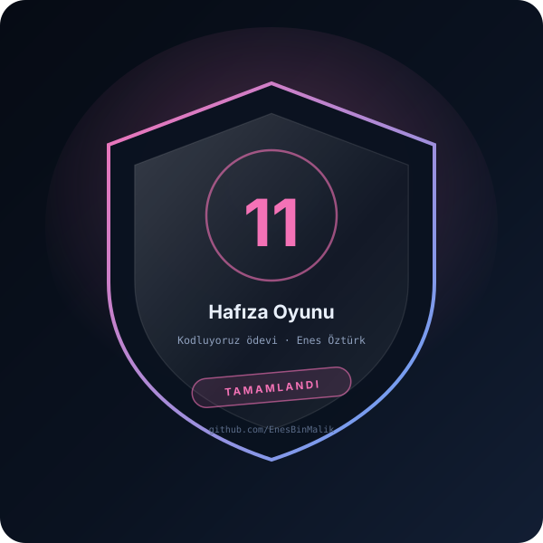

# Hafıza Oyunu — Frontend Projeleri



> **Kodluyoruz · OYUN** — tasarım ve geliştirme: **Enes Öztürk**

<p align="center"></p>

---

Frontend Web Development Seviye 2 ödevi: 4×3 matris kart eşleştirme, hamle sayacı, en iyi skor ve zafer ekranı.

## Öne çıkanlar

- **4×3 matris** — 6 çift kart, karıştırılmış dizilim
- **Skor tahtası** — hamle, eşleşme ve süre (`GameScoreboard`)
- **En iyi skor** — tarayıcıda saklanan rekor
- **Zafer ekranı** — `VictoryModal` ve konfeti (`utils/confetti.ts`)
- **Ses efektleri** — `utils/audio.ts` ile üretilen tonlar
- **Proje gereksinimleri** — `ProjectRequirementsModal`

## Teknoloji

React · TypeScript · Vite · Web Audio · canvas-confetti

## Kurulum ve çalıştırma

```bash
npm install
npm run dev        # http://localhost:3000
```

| Komut | Not |
| --- | --- |
| `npm install` | bağımlılıklar |
| `npm run dev` | geliştirme sunucusu |
| `npm run build` | üretim derlemesi |

## Proje yapısı

```
hafıza-oyunu---frontend-projeleri-_-enes-öztürk/
├── index.html
├── package.json
├── docs/
│   ├── kapak.svg          # elle çizilmiş proje kapağı
│   └── rozet.svg          # imza rozeti
└── src/
```

## Lisans

MIT · bu proje **Enes Öztürk** tarafından geliştirilmiştir.
