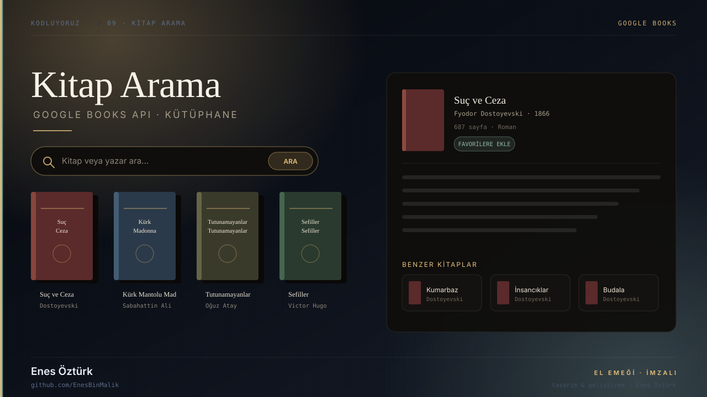
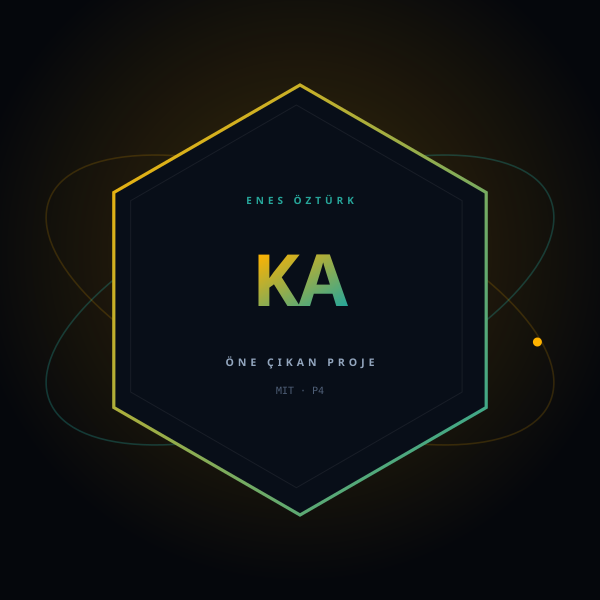

# Kitap Arama Uygulaması



> **Kodluyoruz · GOOGLE BOOKS** — tasarım ve geliştirme: **Enes Öztürk**

<p align="center"></p>

---

Google Books API üzerinden kitap ve yazar araması yapan; kapak, sayfa sayısı ve yayın bilgisini gösteren interaktif kütüphane.

## Öne çıkanlar

- **Arama** — kitap adı veya yazara göre `SearchBar`
- **Sonuç kartları** — `BookCard` · `BookCover` ile kapak görünümü
- **Detay penceresi** — `BookDetailModal` ile künye ve açıklama
- **Favoriler** — `FavoritesDrawer` ile kaydedilen kitaplar
- **Servis katmanı** — `src/services` üzerinden Google Books istekleri

## Teknoloji

React · TypeScript · Vite · Google Books API

## Kurulum ve çalıştırma

```bash
npm install
npm run dev        # http://localhost:3000
```

| Komut | Not |
| --- | --- |
| `npm install` | bağımlılıklar |
| `npm run dev` | geliştirme sunucusu |
| `npm run build` | üretim derlemesi |

## Proje yapısı

```
kitap-arama-uygulaması---enes-öztürk/
├── index.html
├── package.json
├── docs/
│   ├── kapak.svg          # elle çizilmiş proje kapağı
│   └── rozet.svg          # imza rozeti
└── src/
```

## Lisans

MIT · bu proje **Enes Öztürk** tarafından geliştirilmiştir.
