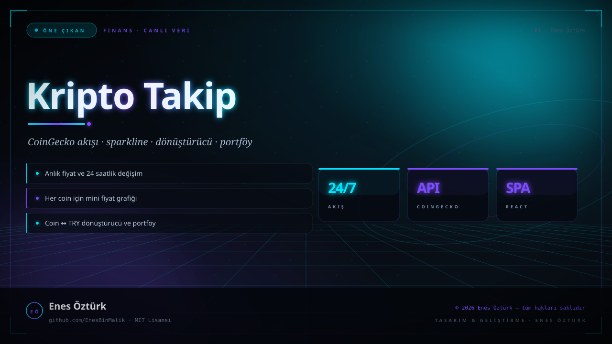
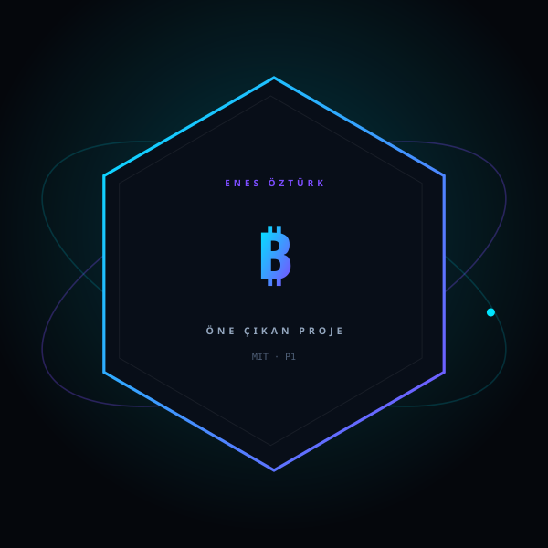

# Kripto Para — Canlı Fiyat Takip Platformu



> **Kodluyoruz · FİNANS** — tasarım ve geliştirme: **Enes Öztürk**

<p align="center"></p>

---

Kripto paraların anlık fiyatını, değişim oranını ve piyasa hareketini takip eden; arama, filtreleme, dönüştürücü ve portföy panelini tek ekranda toplayan platform.

## Öne çıkanlar

- **Canlı fiyatlar** — CoinGecko servisinden çekilen anlık veriler (`src/services/api.ts`)
- **Coin kartları ve tablo** — `CoinGrid` · `CoinTable` ile iki görünüm
- **Sparkline** — her coin için mini fiyat grafiği
- **Dönüştürücü** — coin ↔ TRY hesaplama
- **Arama ve filtre** — `Search` · `FilterBar` ile hızlı gezinme
- **Portföy** — tutulan varlıkların toplam değeri

## Teknoloji

React 19 · TypeScript · Vite · CoinGecko API · lucide-react

## Kurulum ve çalıştırma

```bash
npm install
npm run dev        # http://localhost:3000
```

| Komut | Not |
| --- | --- |
| `npm install` | bağımlılıklar |
| `npm run dev` | geliştirme sunucusu (chat: `tsx server.ts`) |
| `npm run build` | üretim derlemesi |

## Proje yapısı

```
kripto-para---canlı-fiyat-takip-platformu/
├── index.html
├── package.json
├── docs/
│   ├── kapak.svg          # elle çizilmiş proje kapağı
│   └── rozet.svg          # imza rozeti
└── src/
```

## Lisans

MIT · bu proje **Enes Öztürk** tarafından geliştirilmiştir.
