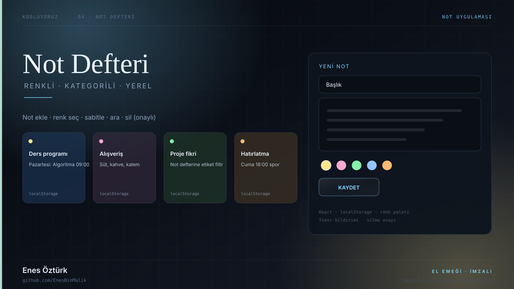
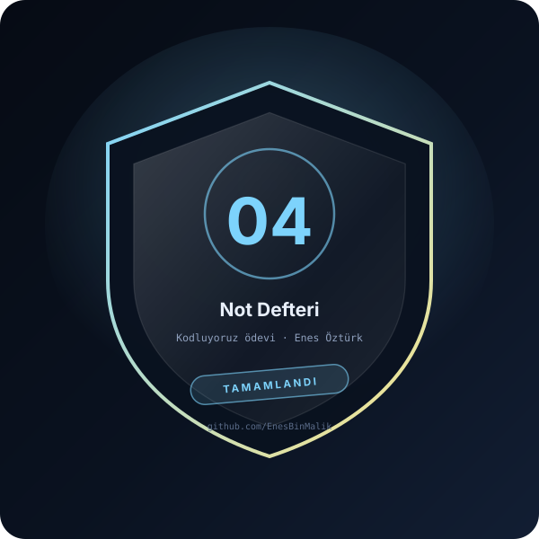

# Not Defteri



> **Kodluyoruz · NOT UYGULAMASI** — tasarım ve geliştirme: **Enes Öztürk**

<p align="center"></p>

---

Renkli ve kategorili not tutma uygulaması: not ekleme, renk seçimi, sabitleme, arama ve onaylı silme; tüm veriler tarayıcıda (localStorage) kalır.

## Öne çıkanlar

- **Not oluşturma** — başlık, içerik ve renk paleti
- **Kategoriler ve arama** — başlık/içerik içinde filtre
- **Sabitleme** — önemli notlar listenin başında
- **Onaylı silme** — `DeleteConfirmModal` ile yanlışlık koruması
- **Kalıcılık** — `src/utils/storage.ts` üzerinden localStorage

## Teknoloji

React · TypeScript · Vite · lucide-react

## Kurulum ve çalıştırma

```bash
npm install
npm run dev        # http://localhost:3000
```

| Komut | Not |
| --- | --- |
| `npm install` | bağımlılıklar |
| `npm run dev` | geliştirme sunucusu |
| `npm run build` | üretim derlemesi |

## Proje yapısı

```
not-defteri---enes-öztürk/
├── index.html
├── package.json
├── docs/
│   ├── kapak.svg          # elle çizilmiş proje kapağı
│   └── rozet.svg          # imza rozeti
└── src/
```

## Lisans

MIT · bu proje **Enes Öztürk** tarafından geliştirilmiştir.
