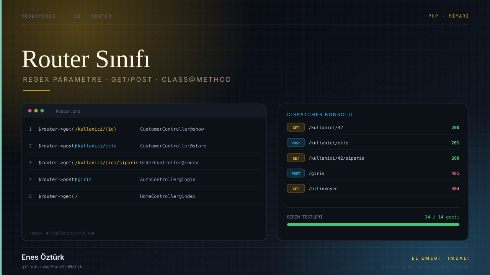
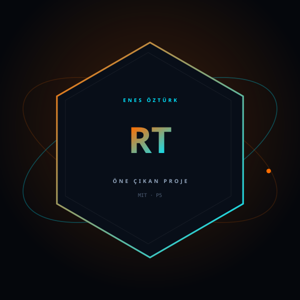

# Router Sınıfı



> **Kodluyoruz · PHP · MİMARİ** — tasarım ve geliştirme: **Enes Öztürk**

<p align="center"></p>

---

Müşteri yönetim sistemi için regex parametreli, GET/POST ayrımı ve Class@Method çağrımı destekleyen gelişmiş Router sınıfı ve test platformu.

## Öne çıkanlar

- **Router sınıfı** — `src/router` içinde rota kaydı ve eşleştirme
- **Regex parametreler** — `/kullanici/{id}` gibi dinamik yollar
- **GET/POST ayrımı** — aynı yol, farklı işleyici
- **Dispatcher konsolu** — `DispatcherConsole` ile canlı istek deneme
- **Rota tablosu** — `RouteTableView` ile kayıtlı yollar
- **Birim testleri** — `UnitTestRunner` ve `CodeExportView`

## Teknoloji

React · TypeScript · Vite · PHP tarzı router mimarisi

## Kurulum ve çalıştırma

```bash
npm install
npm run dev        # http://localhost:3000
```

| Komut | Not |
| --- | --- |
| `npm install` | bağımlılıklar |
| `npm run dev` | geliştirme sunucusu |
| `npm run build` | üretim derlemesi |

## Proje yapısı

```
router-sınıfı---enes-öztürk/
├── index.html
├── package.json
├── docs/
│   ├── kapak.svg          # elle çizilmiş proje kapağı
│   └── rozet.svg          # imza rozeti
└── src/
```

## Lisans

MIT · bu proje **Enes Öztürk** tarafından geliştirilmiştir.
