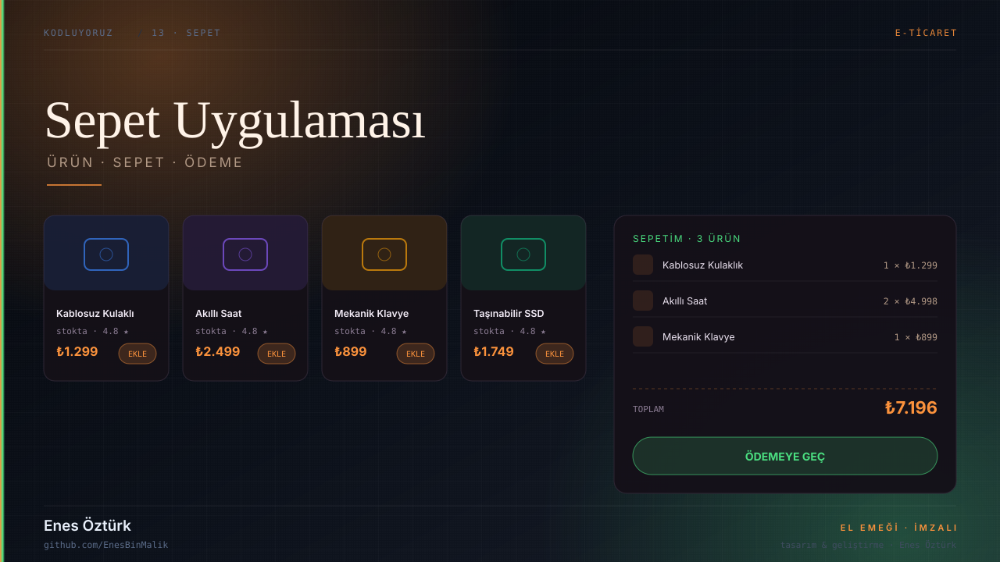
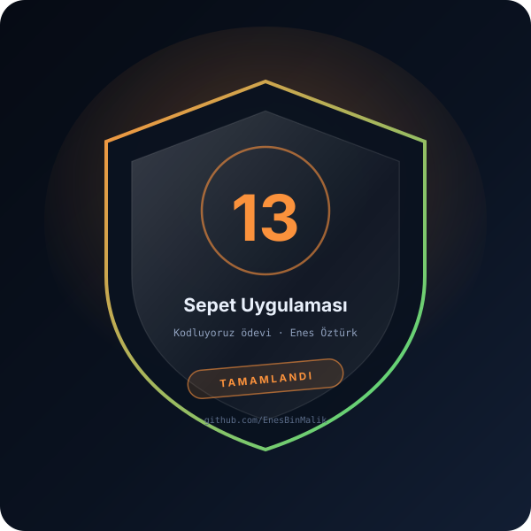

# Sepet Uygulaması



> **Kodluyoruz · E-TİCARET** — tasarım ve geliştirme: **Enes Öztürk**

<p align="center"></p>

---

Modern ürün listeleme ve dinamik sepet yönetimi: çoklu ürün ekleme, tekli/toplu silme, ödeme akışı ve bildirim baloncukları.

## Öne çıkanlar

- **Ürün kartları** — `ProductCard` ile fiyat, stok ve puan bilgisi
- **Ürün detayı** — `ProductDetailModal` ile görsel ve açıklama
- **Sepet çekmecesi** — `CartDrawer` ile adet artırma/azaltma
- **Toplu silme** — `ClearCartConfirmModal` ile tek hamlede temizleme
- **Ödeme** — `CheckoutModal` ile sipariş özeti
- **Bildirim** — `Toast` bileşeni ve `SignatureModal` imzası

## Teknoloji

React · TypeScript · Vite · Context API

## Kurulum ve çalıştırma

```bash
npm install
npm run dev        # http://localhost:3000
```

| Komut | Not |
| --- | --- |
| `npm install` | bağımlılıklar |
| `npm run dev` | geliştirme sunucusu |
| `npm run build` | üretim derlemesi |

## Proje yapısı

```
sepet-uygulaması-_-enes-öztürk/
├── index.html
├── package.json
├── docs/
│   ├── kapak.svg          # elle çizilmiş proje kapağı
│   └── rozet.svg          # imza rozeti
└── src/
```

## Lisans

MIT · bu proje **Enes Öztürk** tarafından geliştirilmiştir.
