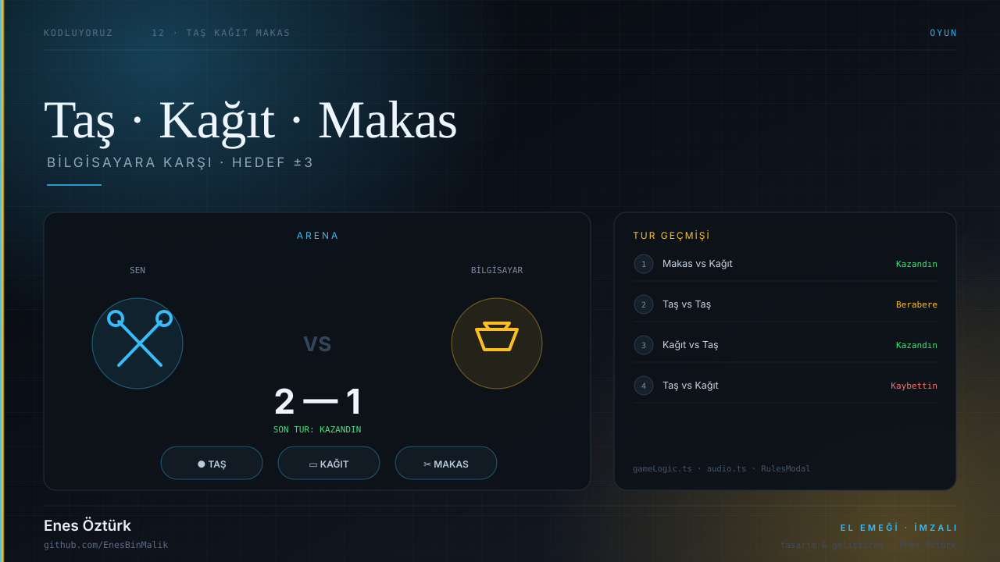
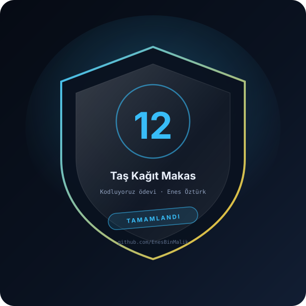

# Taş Kağıt Makas



> **Kodluyoruz · OYUN** — tasarım ve geliştirme: **Enes Öztürk**

<p align="center"></p>

---

Bilgisayara karşı oynanan Taş Kağıt Makas: hedef +3 veya −3 puan, tur geçmişi ve detaylı skor istatistikleri.

## Öne çıkanlar

- **Arena** — seçim, rakip hamlesi ve tur sonucu tek ekranda
- **Kontroller** — `ChoiceControls` ile taş, kağıt, makas
- **Skor** — `ScoreBoard` ile puan ve seri takibi
- **Tur geçmişi** — `HistoryList` ile hamle dökümü
- **Kurallar** — `RulesModal` ve oyun sonu ekranı
- **Ses** — `utils/audio.ts` ile tur sesleri

## Teknoloji

React · TypeScript · Vite · Web Audio

## Kurulum ve çalıştırma

```bash
npm install
npm run dev        # http://localhost:3000
```

| Komut | Not |
| --- | --- |
| `npm install` | bağımlılıklar |
| `npm run dev` | geliştirme sunucusu |
| `npm run build` | üretim derlemesi |

## Proje yapısı

```
taş-kağıt-makas/
├── index.html
├── package.json
├── docs/
│   ├── kapak.svg          # elle çizilmiş proje kapağı
│   └── rozet.svg          # imza rozeti
└── src/
```

## Lisans

MIT · bu proje **Enes Öztürk** tarafından geliştirilmiştir.
