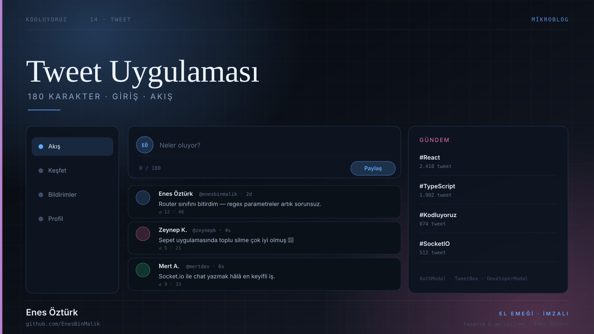
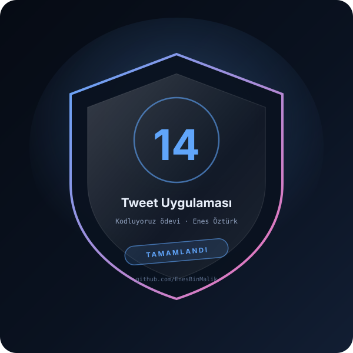

# Tweet Uygulaması



> **Kodluyoruz · MİKROBLOG** — tasarım ve geliştirme: **Enes Öztürk**

<p align="center"></p>

---

180 karakter sınırlı mikroblog: kullanıcı kayıt/giriş sistemi, en yeni tweetlerin başta gösterildiği akış ve trend paneli.

## Öne çıkanlar

- **Kimlik doğrulama** — `AuthModal` ile kayıt ve giriş
- **Tweet kutusu** — `TweetBox` ile 180 karakter sayacı
- **Akış** — en yeni tweetler başta (`TweetCard`)
- **Kenar çubukları** — `Sidebar` gezinme, `RightSidebar` gündem
- **Durum yönetimi** — `src/context` üzerinden oturum
- **Geliştirici notu** — `DeveloperModal`

## Teknoloji

React · TypeScript · Vite · Context API

## Kurulum ve çalıştırma

```bash
npm install
npm run dev        # http://localhost:3000
```

| Komut | Not |
| --- | --- |
| `npm install` | bağımlılıklar |
| `npm run dev` | geliştirme sunucusu |
| `npm run build` | üretim derlemesi |

## Proje yapısı

```
tweet-uygulaması---enes-öztürk/
├── index.html
├── package.json
├── docs/
│   ├── kapak.svg          # elle çizilmiş proje kapağı
│   └── rozet.svg          # imza rozeti
└── src/
```

## Lisans

MIT · bu proje **Enes Öztürk** tarafından geliştirilmiştir.
