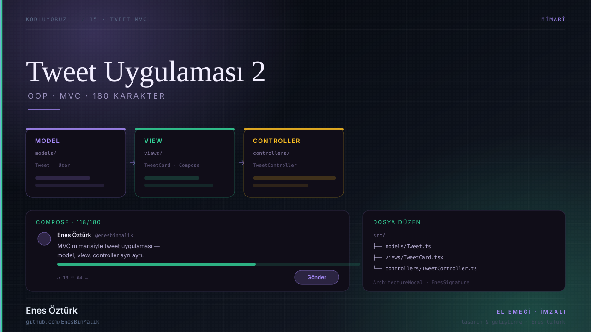
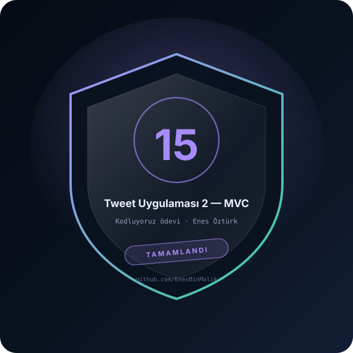

# Tweet Uygulaması 2 — MVC



> **Kodluyoruz · MİMARİ** — tasarım ve geliştirme: **Enes Öztürk**

<p align="center"></p>

---

OOP ve MVC mimarisiyle kurulmuş, 180 karakter limitli ve arkadaş odaklı tweet platformu: model, view ve controller katmanları ayrı.

## Öne çıkanlar

- **Model katmanı** — `src/models` içinde Tweet ve User sınıfları
- **View katmanı** — `src/views` ve `TweetCard` bileşenleri
- **Controller katmanı** — `src/controllers` iş kuralları
- **Mimari görünümü** — `ArchitectureModal` ile katman şeması
- **Tweet oluşturma** — `ComposeTweet` ve karakter çubuğu
- **İmza** — `EnesSignature` bileşeni

## Teknoloji

React · TypeScript · Vite · OOP · MVC

## Kurulum ve çalıştırma

```bash
npm install
npm run dev        # http://localhost:3000
```

| Komut | Not |
| --- | --- |
| `npm install` | bağımlılıklar |
| `npm run dev` | geliştirme sunucusu |
| `npm run build` | üretim derlemesi |

## Proje yapısı

```
tweet-uygulaması-2---enes-öztürk/
├── index.html
├── package.json
├── docs/
│   ├── kapak.svg          # elle çizilmiş proje kapağı
│   └── rozet.svg          # imza rozeti
└── src/
```

## Lisans

MIT · bu proje **Enes Öztürk** tarafından geliştirilmiştir.
