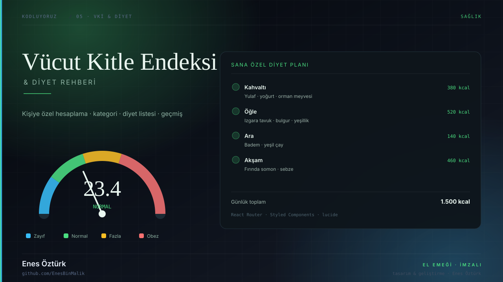

# Vücut Kitle Endeksi & Diyet Rehberi



> **Kodluyoruz · SAĞLIK** — tasarım ve geliştirme: **Enes Öztürk**

<p align="center"></p>

---

Boy ve kilodan vücut kitle endeksini hesaplayan, sonuca göre kişiselleştirilmiş diyet listesi sunan ve geçmişi saklayan sağlık asistanı.

## Öne çıkanlar

- **VKİ hesaplama** — boy, kilo, yaş ve cinsiyete göre
- **Görsel gösterge** — `BmiGauge` ile kategori ölçeği
- **Diyet planı** — öğün öğün liste ve günlük kalori
- **Bilgi sayfaları** — VKİ nedir, tüm diyetler
- **Geçmiş** — önceki hesaplamalar sayfası

## Teknoloji

React · TypeScript · Vite · React Router · styled-components · lucide-react

## Kurulum ve çalıştırma

```bash
npm install
npm run dev        # http://localhost:3000
```

| Komut | Not |
| --- | --- |
| `npm install` | bağımlılıklar |
| `npm run dev` | geliştirme sunucusu |
| `npm run build` | üretim derlemesi |

## Proje yapısı

```
vücut-kitle-endeksi-&-diyet-rehberi/
├── index.html
├── package.json
├── docs/
│   ├── kapak.svg          # elle çizilmiş proje kapağı
│   └── rozet.svg          # imza rozeti
└── src/
```

## Lisans

MIT · bu proje **Enes Öztürk** tarafından geliştirilmiştir.
